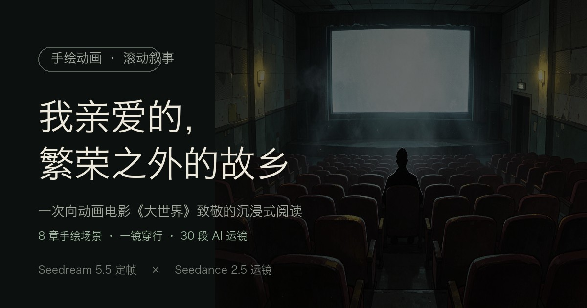

# 我亲爱的，繁荣之外的故乡 — 大世界式滚动叙事网页

🔗 **在线体验（Vercel）**：部署中，链接将在发布后更新。



一篇散文的沉浸式滚动改编：8 个手绘二维动画场景，一镜向前穿行，视觉对标刘健动画电影
《大世界》（扁平手绘色块、粗黑描边、印刷网点、灰绿荧光色调）。滚动即擦洗视频时间轴，
桌面横屏与手机原生竖屏各一条完整运镜链。

> **交付版本**：480p 横屏 + 480p 原生竖屏视频（站点 `site/` 当前即此版本，30 段）。
> 2K webp 海报保证静态帧清晰，480p 视频负责滚动擦洗的运动。1080p 通路已验证可用
> （`gen_chain.sh final`），如日后需要更高清晰度，重跑成片管线再 `finish.sh` 即可。

- 定帧：火山方舟 Seedream 5.5（`doubao-seedream-5-5-261028`），带电影截图风格参考
- 运镜：火山方舟 Seedance 2.5（`doubao-seedance-2-5-260628`），首帧锁定 + 转场首尾双锁
- 引擎：scroll-world 的 scrub-engine（scroll 擦洗视频，blob seek，本地增量补丁：quote 字段、`sw:progress` 事件）
- 文案已匿名化：二伯→一个伯伯，上海→S 市，安徽→A 省，广德→B 市

## 目录

```
site/                 网站本体（直接部署这个目录）
  index.html          8 章文案与引擎配置
  styles.css          暗色文学主题 + 8 种场景特效（蒸汽/尘雾/水影/霓虹/飞蛾/烟缕/金光/放映束）
  immersive.js        开场封面、特效绑定、鼠标微视差
  scrub-engine.js     滚动擦洗引擎（含本地补丁）
  assets/             webp 海报 + vid/ 成片 mp4
scripts/
  arkgen25.py         Ark REST 封装（图/视频，base64 首尾帧）
  gen_stills.sh       横屏定帧批量生成
  gen_stills_m.sh     竖屏定帧（9:16，手机链首帧）
  make_mobile_prompts.py
  gen_chain.sh        运镜链：8 dive → 抽首尾帧 → 7 connector（previz/final × desk/mobile）
  prep_posters.py     定帧转 webp 海报
  encode.sh           滚动擦洗专用编码（桌面 crf20 gop8 / 手机 720p gop4）
  serve.sh            本地预览服务器
work/                 中间产物（prompts / stills / vid / frames / logs）
reference/            文章内嵌的 6 张《大世界》电影画面，仅作风格参考
article_clean.md      匿名化后的文章工作稿
```

## 渲染管线

```bash
# 0. 环境：platform 通道 ARK_API_KEY（arkcli SSO 过期时 REST 直连仍可用）
# 1. 定帧（横+竖）
bash scripts/gen_stills.sh
bash scripts/gen_stills_m.sh
/usr/bin/python3 scripts/prep_posters.py
# 2. 480p 预演链（验证创意与接缝）
bash scripts/gen_chain.sh previz            # 横屏
CHAIN=mobile bash scripts/gen_chain.sh previz   # 竖屏
bash scripts/encode.sh previz desk
bash scripts/encode.sh previz mobile
# 3. 预演确认后，1080p / 720p 成片（断点安全，已存在片段自动跳过）
bash scripts/gen_chain.sh final
CHAIN=mobile bash scripts/gen_chain.sh final
bash scripts/encode.sh final desk
bash scripts/encode.sh final mobile
# 4. 预览
bash scripts/serve.sh
```

## 关键坑（本项目实测，2026-11）

- **Seedance 2.5 图生视频不接受 `ratio` 参数**（传了 400 `TaskTypeConstraint`），输出比例
  严格跟随首帧图。横屏链喂 16:9 首帧、竖屏链喂 9:16 首帧（`work/stills_m`，1152×2048）。
- **1080p 已验证可用**：`resolution=1080p` 出 1920×1080；5s≈245k tokens、8s≈389k tokens。
  480p 5s≈48k tokens，适合预演。
- 接缝铁律：connector 的首帧=上一段 dive 的真实末帧、末帧=下一段 dive 的真实首帧
  （ffmpeg 抽帧）。实测首帧锁 34–48dB、末帧锁 21–35dB，引擎另加 0.14vh 交叉淡化兜底。
- homebrew python3.14 无系统 CA 且 `-I` 隔离模式会屏蔽用户级 PIL：调 Ark API 用
  `/usr/bin/python3`（3.9 + certifi）；用 PIL 时用 `/usr/bin/python3` 但不要加 `-I`。
- `encode.sh` 的 mobile 源文件名已带 `-m`，不能再追加一次后缀（曾产出 `-m-m.mp4`，已修）。
- 定帧 prompt 全程禁止可读文字、招牌用抽象色块；但视频模型在竖屏霓虹场景会自己生成
  正确汉字招牌（桌球店/网吧），属可接受的真实感增益。
- 本机 8765 端口可能被并行会话占用，本项目服务器默认 **8766**。
- 参考图（reference/ 6 张《大世界》截图）只借风格/笔触/色调，prompt 明确禁止照搬内容。

## 本地预览

```bash
bash scripts/serve.sh        # http://localhost:8766 （blob 抓取需 http，不能 file:// 直开）
# 自动化 QA（先起服务器）：
node scripts/qa.js 8766 work/qa_shots                 # 桌面 1600 宽
QA_W=390 QA_H=844 node scripts/qa.js 8766 work/qa_m   # 手机视口，校验原生竖屏供给
```
